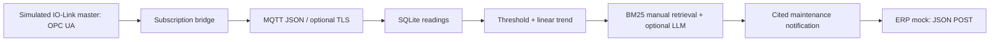

# iiot-maintenance-agent

[](https://github.com/sulemanali5760/iiot-maintenance-agent/actions/workflows/ci.yml)

A small Python demonstration of the shop-floor-to-maintenance chain: simulated pump sensors,
OPC UA, MQTT, SQLite, fixed limits and a linear trend, followed by a maintenance notification
with cited manual passages. Written by Suleman Ali, automation engineer and M.Sc. EE student,
to show the integration work behind an IIoT maintenance workflow. No real hardware or SAP system
is involved.



## Install and run offline

Python 3.11 or newer. From this checkout:

```powershell
python -m pip install -e .
iiot-agent demo
```

The demo uses `values_at`, an in-memory bus and SQLite with no broker, server, sleep or API key.
It prints the first WARN and ALARM per sensor, SQL measurements, a time-to-alarm-limit estimate,
notification JSON with three cited sections, and the total readings stored. Seed 7 and fixed UTC
timestamps make offline runs repeatable. Use `--db demo.db` to persist readings.

The default run is 160 one-second steps; the bearing-wear fault starts at step 40, vibration reaches
WARN (4.5 mm/s) around step 94 and ALARM (7.1 mm/s) around step 146.

Output of `iiot-agent demo`, copied from the CI run (Ubuntu, Python 3.12):

```text
$ iiot-agent demo
Alarm: vibration WARN 4.517 mm/s; time to alarm limit: 51.0 s
Notification: {"NotificationType": "M2", "Equipment": "P101", "FunctionalLocation": "PLANT-LINE1-P101", "Priority": 2, "ShortText": "vibration WARN: P101", "LongText": "vibration: 4.517 mm/s at 2026-01-01T00:01:34+00:00; state WARN. Last 20 readings SQL stats: {'count': 20, 'min': 3.5417296392857964, 'max': 4.516607958826345, 'avg': 4.0283152512585865}. Linear trend time to alarm limit: 51.0 seconds.\nRecommended steps: [Vibration and bearing wear] Rising vibration can indicate bearing wear; inspect the bearing before continued operation. [Bearing temperature] Rising bearing temperature can indicate insufficient lubrication or bearing damage. [Bearing replacement and lock-out/tag-out] Stop the pump and apply the site's lock-out/tag-out procedure before bearing replacement.", "Sources": ["Vibration and bearing wear", "Bearing temperature", "Bearing replacement and lock-out/tag-out"]}
Alarm: vibration ALARM 7.103 mm/s; time to alarm limit: 0.0 s
Notification: {"NotificationType": "M2", "Equipment": "P101", "FunctionalLocation": "PLANT-LINE1-P101", "Priority": 1, "ShortText": "vibration ALARM: P101", "LongText": "vibration: 7.103 mm/s at 2026-01-01T00:02:26+00:00; state ALARM. Last 20 readings SQL stats: {'count': 20, 'min': 6.164864103877276, 'max': 7.1033043888026475, 'avg': 6.62394869821197}. Linear trend time to alarm limit: 0.0 seconds.\nRecommended steps: [Vibration and bearing wear] Rising vibration can indicate bearing wear; inspect the bearing before continued operation. [Bearing temperature] Rising bearing temperature can indicate insufficient lubrication or bearing damage. [Bearing replacement and lock-out/tag-out] Stop the pump and apply the site's lock-out/tag-out procedure before bearing replacement.", "Sources": ["Vibration and bearing wear", "Bearing temperature", "Bearing replacement and lock-out/tag-out"]}
Readings stored: 480
```

At WARN the linear trend estimates 51 s until the alarm limit; the alarm follows 52 steps (seconds) later.

## Running against a real broker

Start your MQTT broker separately. Run these in separate terminals:

```powershell
iiot-agent sim --period 1 --fault-start 40
iiot-agent bridge --endpoint opc.tcp://127.0.0.1:4841/iolink/ --mqtt-host localhost --mqtt-port 1883
iiot-agent store --mqtt-host localhost --mqtt-port 1883 --db readings.db
iiot-agent watch --mqtt-host localhost --mqtt-port 1883 --db watch.db
```

`sim` exposes OPC UA; it does not use MQTT. `bridge`, `store` and `watch` accept `--mqtt-host`,
`--mqtt-port`, `--client-id`, `--line`, `--tls-ca`, `--tls-cert` and `--tls-key`. Client IDs default
to broker-generated unique IDs. Store and watch both ingest messages into their own SQLite file;
use separate files when running both, to avoid duplicate samples. Watch detects on incoming samples.
All long-running commands stop with Ctrl+C.

The three ports represent vibration velocity (mm/s), bearing temperature (°C), and discharge
pressure (bar) for P101. `ProcessValue` is Double; `Unit` and `VendorDevice` are string properties;
`DeviceStatus` is Int32 (0 OK, 1 maintenance required, 2 out of specification, 4 failure).
The simulator emits 0, 1 or 2 from its example limits. These are generic simulated sensors,
not vendor device models. OPC UA is anonymous and unencrypted for localhost demonstration.

MQTT uses QoS 1 and topics `plant/line1/P101/vibration` (or temperature/pressure), carrying
`asset`, `sensor`, `value`, `unit`, `ts` (ISO 8601 UTC), and `status`. QoS 1 may deliver duplicates;
storage does not deduplicate. Subscribe before starting the bridge to receive initial samples.

## Connecting to AWS IoT Core

Create a thing certificate and private key, attach an appropriate publish/subscribe policy,
and obtain the Amazon root CA and your account's ATS endpoint. For example, replace the
endpoint placeholder and local file names:

```powershell
iiot-agent bridge --mqtt-host xxxx-ats.iot.<region>.amazonaws.com --mqtt-port 8883 --client-id P101-bridge --tls-ca AmazonRootCA1.pem --tls-cert thing-certificate.pem.crt --tls-key private.pem.key
iiot-agent watch --mqtt-host xxxx-ats.iot.<region>.amazonaws.com --mqtt-port 8883 --client-id P101-watch --tls-ca AmazonRootCA1.pem --tls-cert thing-certificate.pem.crt --tls-key private.pem.key --db watch.db
```

TLS certificate options default the port to 8883 and keep server certificate verification enabled.
Keep private keys outside the repository. This is the certificate authentication pattern used by
AWS IoT Core and Azure IoT Hub-style brokers; Azure-specific topic and identity conventions are
not implemented. CI is configured to test against Mosquitto; it has not been run here, and AWS
has not been tested. After a successful CI run, the intended validation label is:
"tested in CI against Mosquitto; not yet run against AWS".

## Detection and its limits

Only the latest value determines the state. Vibration warns at 4.5 mm/s and alarms at 7.1 mm/s:
these are the commonly quoted ISO 10816-3 zone boundaries for group 2 machines on flexible
foundations, and must be set per machine. Temperature warns at 70 °C and alarms at 85 °C.
Pressure below 4.0 bar alarms. Edit `detect.LIMITS` for a different example machine.

The last 20 readings provide a least-squares linear slope and seconds until the alarm limit.
A flat or falling trend gives no estimate; an already reached limit gives zero for a rising trend.
The low-pressure alarm has no time estimate because the helper models increasing values only.
This is an estimate from a linear trend, not a validated lifetime model. There is no hysteresis,
noise filtering, frequency analysis, calibration or machine-specific validation. Notifications
are emitted once per state per sensor per process run, not on every repeated threshold crossing.

## The maintenance agent

The bundled original fictional manual has nine sections. Pure Python BM25 ranks passages from
sensor, state and trend words; the top three headings become `Sources`. The default summary
uses SQL count/min/max/average, measured values, the linear estimate and each passage's first
sentence, cited by heading. All manual intervals, quantities and spare part numbers are examples.

Optional LLM text uses the same measurements and passages, with instructions to use only those
and cite headings. This is a prompt restriction, not a guarantee of accuracy; review generated
text before acting. Install the extra and set your API key outside source control:

```powershell
python -m pip install -e '.[llm]'
# Set ANTHROPIC_API_KEY in your environment before running:
iiot-agent demo --steps 160 --llm
```

The model comes from `IIOT_AGENT_MODEL`, default `claude-sonnet-5-5`; availability has not been
verified here. Tests use a fake LLM and make no API calls.

## ERP mock

`demo` and `watch` accept `--erp-url http://127.0.0.1:8000/notifications` to POST JSON to a server
you provide. Without it the JSON is printed. This is a mock of an SAP PM notification endpoint
(field names follow the notification object; no SAP system is involved). Fields include M2,
equipment P101, functional location PLANT-LINE1-P101, priority 1 for ALARM or 2 for WARN,
short text of at most 40 characters, long text and source headings. There is no SAP authentication,
mapping, retry queue or delivery deduplication; HTTP failures propagate.

## Checks

```powershell
python -m pip install -r requirements-dev.txt -e .
python -m pytest -v
python -m pip_audit -r requirements-dev.txt
```

Tests cover limits, known linear trends, SQL queries, MQTT topic filters, retrieval, a fake LLM,
local HTTP POST, seeded demo output and an in-process OPC UA server/subscription. Set `MQTT_HOST`
and optionally `MQTT_PORT` to run the two-client broker test; otherwise it skips. An unreachable
broker skips locally and fails in CI. CI config targets Windows/Linux and Python 3.11/3.12,
starting Mosquitto on Linux. These checks still need execution: Python was not on PATH in the
implementation environment. No claim is made about hardware, operational accuracy or customers.

## Licence

MIT
